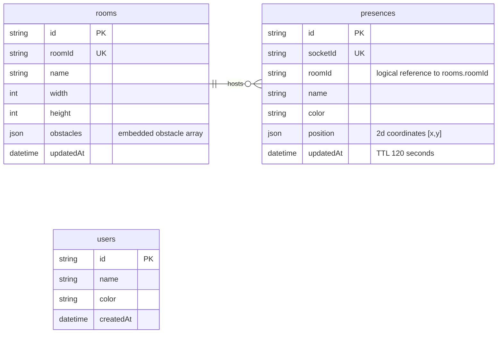

# Database reference

MongoDB Atlas stores the persistent office layout and registered display names. Presence documents represent temporary live positions.

## Collections

### `presences` — live positions

| Field | Type | Meaning |
|---|---|---|
| `socketId` | String, unique | Socket identity for the connected user |
| `roomId` | String | Room identifier, normally `main` |
| `name`, `color` | String | Display information |
| `position` | Number array `[x, y]` | Position in office pixels |
| `updatedAt` | Date | Refreshed on write; TTL removes stale records after 120 seconds |

Indexes include unique `socketId`, `{ position: "2d", roomId: 1 }` with bounds 0–1100, and a TTL index on `updatedAt` with `expireAfterSeconds: 120`.

### `rooms` — saved office layouts

```js
{
  roomId: 'main',
  name: 'Infotact HQ',
  width: 1000,
  height: 600,
  obstacles: [{ id, x, y, w, h, label }],
  updatedAt: Date
}
```

### `users` — registered display names

```js
{ name: String, color: String, createdAt: Date }
```

## Proximity query

```js
Presence.find({
  roomId: 'main',
  socketId: { $ne: currentSocketId },
  position: { $near: [x, y], $maxDistance: 100 },
}).limit(8);
```

`$near` finds nearby documents in distance order, measured in pixels by the flat-plane `2d` index.

## Why `2d` instead of `2dsphere`?

The office map is a 1000×600 pixel plane, not latitude/longitude on Earth. A `2d` index uses the map's flat coordinates directly; the configured index bounds are 0–1100.

## Batched presence writes and cleanup

The presence service keeps the latest queued position for each socket and flushes the queue with a bulk write every 300 ms. A heartbeat can refresh connected idle users every 30 seconds. The 120-second TTL index removes abandoned presence records after crashes.

## Socket.IO presence events

With `USE_MONGO_PROXIMITY=true`, a client joins by emitting `presence:join` with `{ roomId, name, x, y }`. It sends `{ x, y }` with `presence:move` as it moves. The acknowledgement includes nearby users from the MongoDB `$near` query and sets `proximitySource` to `mongo`. Presence writes are queued and flushed in batches; disconnect removes that socket's record.

## Collections diagram

The `roomId` on each presence is a logical reference to `rooms.roomId`; MongoDB does not enforce a foreign key. Registered `users` are independent records and are not currently linked to socket presences.


